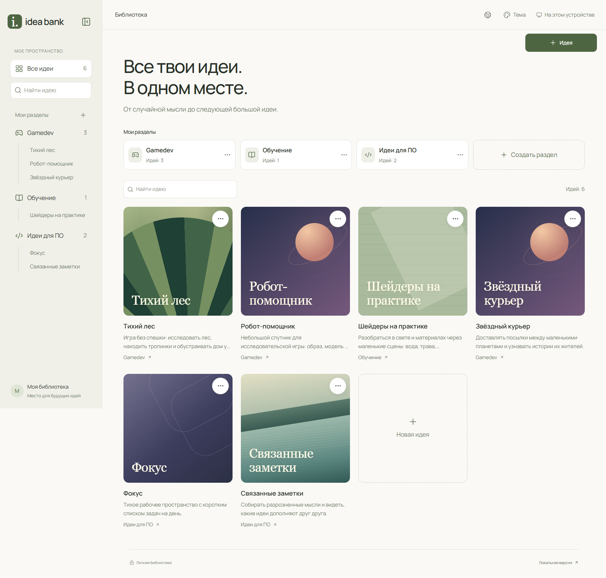
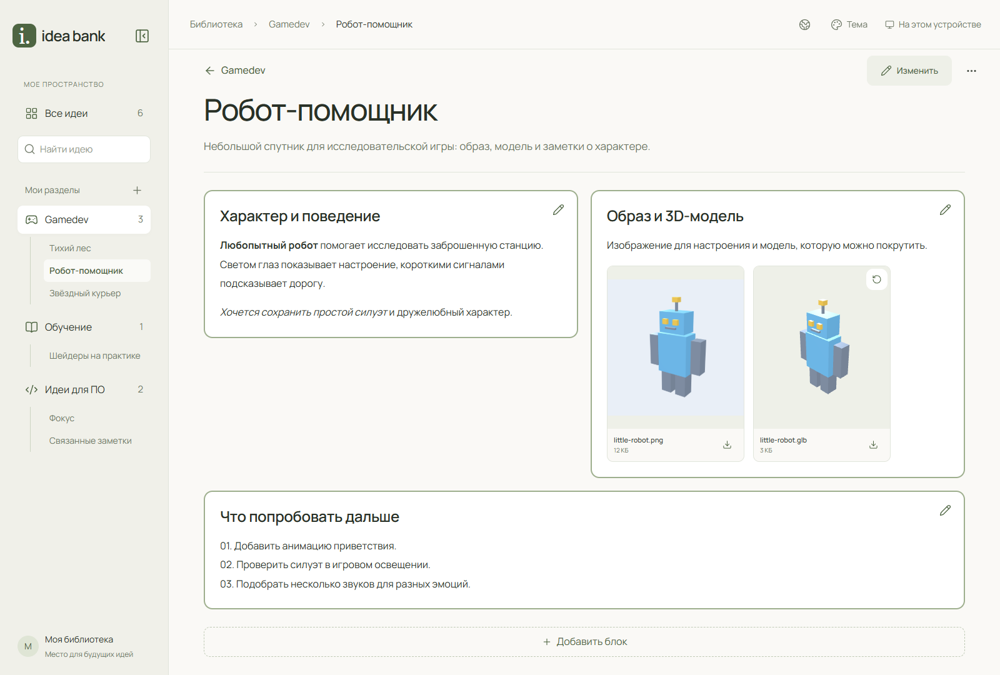
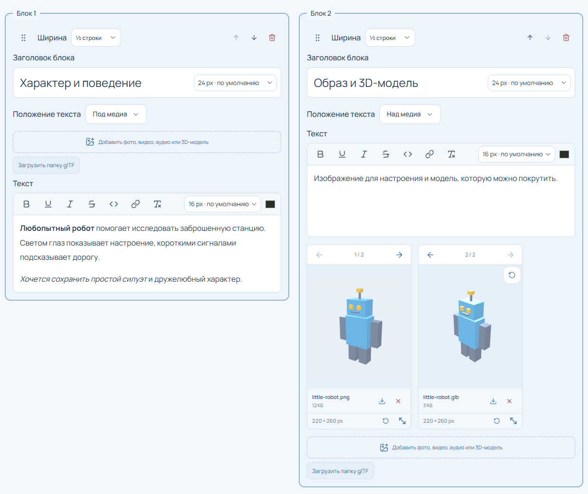
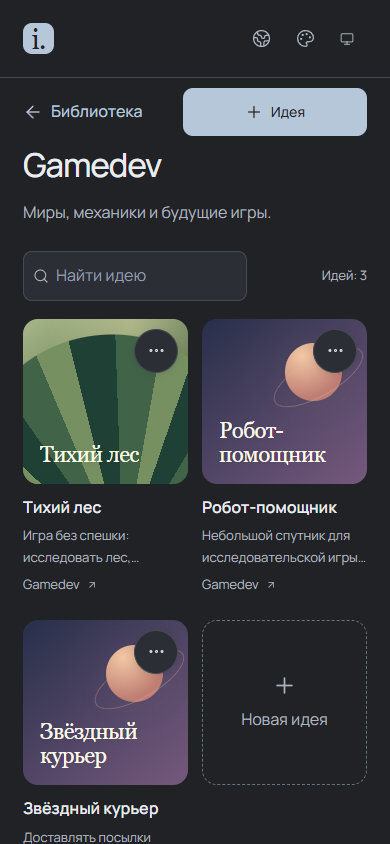
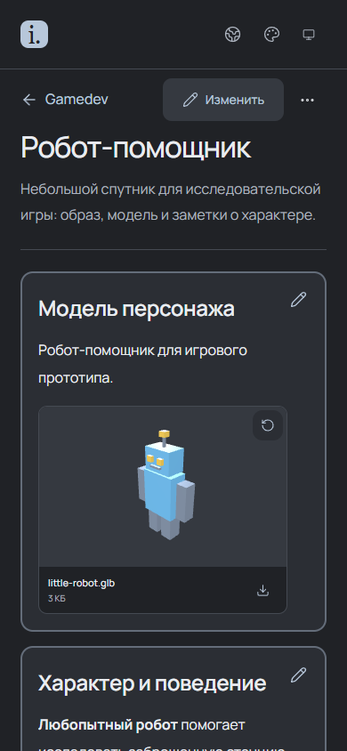

# Idea Bank

<p>
  <a href="README.md"><kbd>Русский</kbd></a>
  <a href="README.en.md"><kbd>English</kbd></a>
</p>

Idea Bank stores ideas and related materials: text notes, images, video, audio, and 3D models. Ideas are grouped into sections, and each idea's content is arranged in blocks.

The application can run locally or as a personal website with sync across devices. Each instance is intended for one owner. The interface language can be changed.

[Features](#features) · [AI-assisted setup](#ai-assisted-setup) · [Agent access](#managing-ideas-through-an-agent) · [Local setup](#local-setup) · [Cloud deployment](#cloud-deployment) · [Backups](#backups)



## Features

### Library organization

Each idea has a title, description, cover, and a page for its materials. Sections group ideas by topic.

### Idea content

An idea page consists of blocks containing text and media. Images, video, audio, and interactive 3D models can be placed alongside notes.



### Block and media layout

The idea editor provides controls for blocks and attachments:



### Mobile interface

A library section and an idea page on a phone:

<p>
  
  
</p>

The screenshots use demonstration data. The initial library contains one idea named **Example**, with text, an image, and a robot 3D model.

## AI-assisted setup

To set up the application with an AI agent, open the repository in its workspace and ask it to deploy a personal instance using the [agent instructions](docs/en/agent-deployment.md). The agent performs the available technical work and guides you through steps that require your participation.

### Managing ideas through an agent

Once connected through MCP, an agent can create and edit ideas, attach media, find entries by an approximate title, and summarize their content. A local library uses STDIO: the client starts the MCP process, and the web application can remain stopped. A separate Streamable HTTP endpoint is available for a cloud library. The connections are independent; local use does not require cloud MCP. [Connect Codex and work with files](docs/en/mcp.md).

## Local setup

Install [Node.js LTS](https://nodejs.org/en/download) and [Git](https://git-scm.com/downloads), then run:

```sh
git clone https://github.com/IdleSpace76/idea-bank.git
cd idea-bank
npm ci
npm run local
```

Open **[http://127.0.0.1:3000](http://127.0.0.1:3000)**. To stop the server, press Ctrl+C in the terminal. Local mode requires no accounts or keys.

The library, drafts, and attachments are saved in the application's `data` folder. Clearing browser data does not delete them. This folder is excluded from Git. Transfers between the local and cloud versions use ZIP files; there is no automatic sync between them. [Migration from an earlier version](docs/en/local-migration.md).

On Windows, double-click [runIdeaBank.cmd](runIdeaBank.cmd). It installs dependencies if needed and opens the browser. Keep the launcher window open.

The `local` and `local:start` commands and the Windows launcher select `IDEA_BANK_AUTH_MODE=local` without changing `.env.local`. The `dev` and `start` commands use the mode from the environment and allow cloud settings to be checked on your computer.

Instead of cloning, you can select **Code → Download ZIP** on GitHub. After extracting it, run commands from the folder containing `package.json`.

<details>
<summary>Run a production build locally</summary>

```sh
npm ci
npm run build
npm run local:start
```

</details>

## Cloud deployment

Deploy the application as a personal website to access it from a computer and phone:

| Service | Purpose |
| --- | --- |
| GitHub | Source code and owner sign-in |
| Vercel | Application and server-side code |
| Backblaze B2 | Private storage for text and media |

The [deployment guide](docs/en/deployment.md) covers the GitHub App, B2, Vercel variables, and initial sync. It describes setup without adding a payment card or buying a domain.

[Vercel Hobby](https://vercel.com/docs/plans/hobby) is suitable for personal, non-commercial use. B2 includes a free storage allowance; download and transaction terms are listed on its [pricing page](https://www.backblaze.com/cloud-storage/pricing).

### Sync across devices

After the initial connection, changes are saved on the device and uploaded in the background while the application is open. With Ably configured, other devices receive notifications and fetch only changes. A fallback check runs every 10 minutes, including without Ably. The current status appears in the top bar. [Configure notifications](docs/en/deployment.md#change-notifications-optional).

After sign-in, the application loads sections and the first idea cards. More cards load as you scroll; an idea's content loads when you open it. After clearing site data, the cloud library is retrieved in the same way. If no library exists yet, the application saves the initial Example idea.

When upgrading an older cloud version, you may need to choose between data saved in the browser and B2. This is part of [legacy format compatibility](docs/en/b2-storage.md#data-safety-and-legacy-library-upgrades). A disk-based local library can be transferred to the website only through ZIP.

Independent changes are merged. If a conflict occurs, the application asks you to select versions of individual records. Incoming updates are deferred while you edit; saved changes wait for upload when the connection is lost. The **Sync** button remains available for manual checks.

## Data storage

In local mode, data is stored on disk: SQLite holds records and drafts, with attachment files stored alongside it. You can move the application folder together with `data` after stopping the web server and local MCP processes using that library. Update MCP connection paths after moving it. [Configure the data folder](docs/en/local-storage.md#data-folder).

In cloud mode, the browser stores viewed data and the upload queue. Repeated navigation and editing use local copies. Updates load in the background after notifications, reconnection, and fallback checks; missing data is requested when opened.

The cloud text and card cache is limited to 32 MiB, and the media cache to 128 MiB. When full, the least recently used cloud copies are removed. Pending changes and original attachments are retained until sync succeeds.

While editing blocks, a local draft is saved after a one-second pause, together with available attachments. After reloading, you can restore it on the idea page. If the blocks have changed, the application offers a version comparison. Drafts do not sync across devices and are deleted after saving the idea or explicitly cancelling the edit.

On the cloud website, an open tab without a network connection can display only ideas and attachments already saved on the device. These pages are marked as offline copies. Opening or reloading the website itself requires a connection. Closed tabs do not sync. The local application works without internet access while its server is running.

Clearing cloud site data deletes that browser's cache and pending changes. Confirmed cloud data can be retrieved from B2 again.

## Backups

1. Save or cancel the current draft.
2. Open **Local version** or **Sync and backups** at the bottom of the page.
3. Select **Export ZIP** and save the archive.
4. To import, select **Import ZIP**, review its contents, and choose **Import ideas**. If idea versions differ, keep the current version, use the archive version, or keep both. With **Keep both**, the archive copy receives the suffix `imported`.

Import adds data from the archive while retaining other ideas and existing sections. Matching ideas are skipped, including on repeated imports.

To replace a library, first select **Clear your head**, then import the archive. Clearing requires confirmation and removes all ideas and sections, including Example. Cloud clearing requires a connection and a completed upload queue; original attachments are not downloaded for this operation. You can add the example separately with **Load Example**. With cloud storage connected, changes are sent to other devices.

Export retrieves a complete library snapshot and any missing attachments while keeping the current page visible. Archive progress appears in the backup dialog. Exporting a cloud library requires a connection. ZIP files are not encrypted; keep them separate from published source code.

## Limitations

- ZIP: up to **512 MiB of uncompressed data** per archive.
- Cloud: up to **1 GiB per media file**.
- 3D rendering requires WebGL. GLB/glTF 2.0 is supported without Draco/KTX2 compression.
- SVG is not imported. Video and audio support depends on browser codecs.

The ZIP limit applies to the entire exported library, including attachments. A larger library cannot be exported as one archive, even if an individual media file is within the cloud upload limit.

Technical limits and cloud history are described in [docs/en/b2-storage.md](docs/en/b2-storage.md).

## License

[MIT](LICENSE), Idea Bank contributors.
