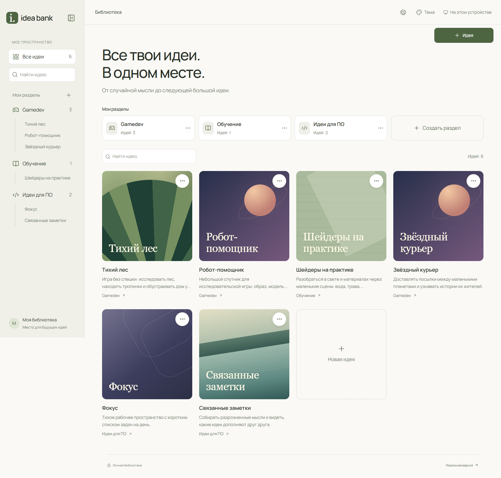
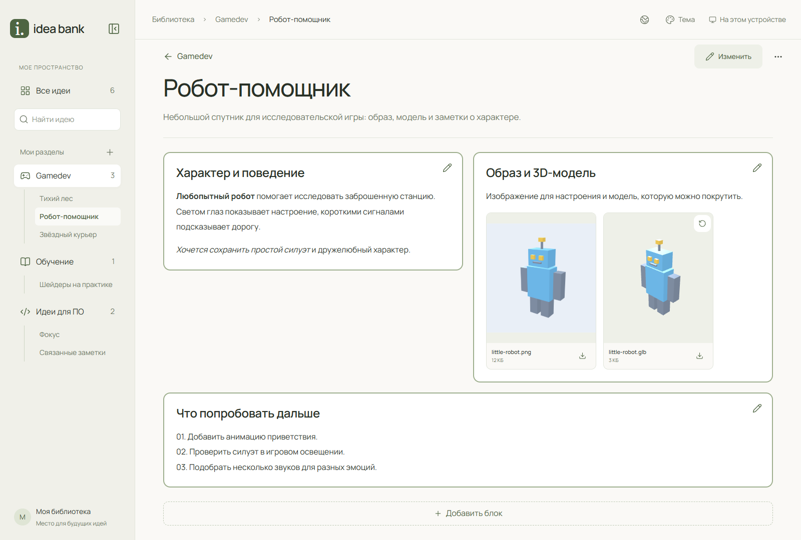
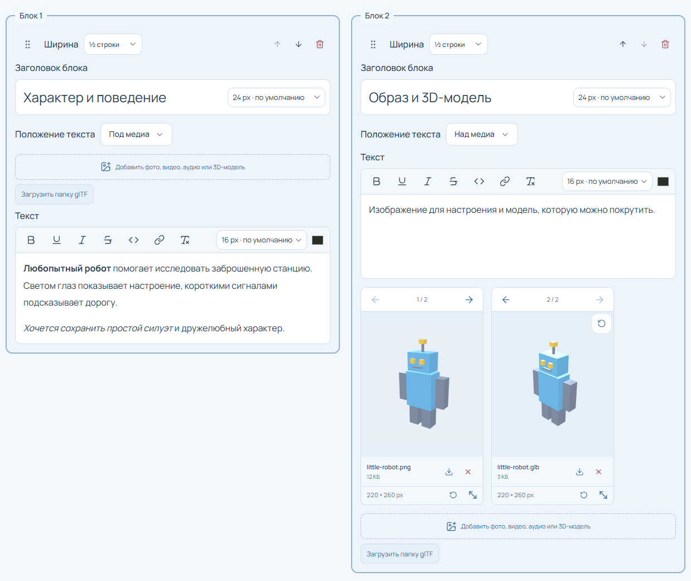
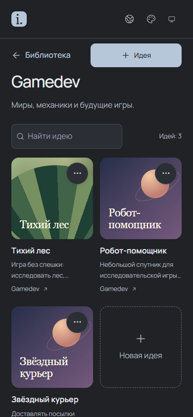
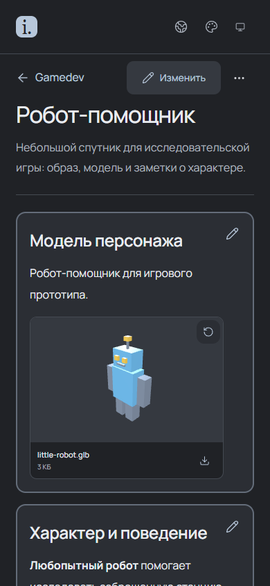

# Idea Bank

Idea Bank предназначен для хранения идей и связанных с ними материалов: текстовых заметок, изображений, видео, аудио и 3D-моделей. Идеи объединяются в разделы, а содержимое каждой идеи размещается в отдельных блоках.

Доступны локальный запуск и личный сайт с синхронизацией между устройствами. Каждый экземпляр рассчитан на одного владельца. Предусмотрена смена языка интерфейса.

[Возможности](#возможности) · [Настройка с ИИ](#настройка-с-помощью-ии-агента) · [Локальный запуск](#локальный-запуск) · [Облачное развёртывание](#облачное-развёртывание) · [Резервные копии](#резервные-копии)



## Возможности

### Организация библиотеки

Каждая идея содержит название, описание, обложку и страницу с материалами. Разделы используются для группировки идей по направлениям.

### Содержимое идеи

Страница идеи состоит из блоков с текстом и медиафайлами. Изображения, видео, аудио и интерактивные 3D-модели размещаются вместе с заметками.



### Расположение блоков и медиа

Редактор идеи с настройками блоков и вложений:



### Мобильный интерфейс

Раздел библиотеки и страница идеи на телефоне:

<p>
  
  
</p>

На скриншотах использованы демонстрационные данные. В стартовой библиотеке присутствует одна идея **Example** с текстом, изображением и 3D-моделью робота.

## Настройка с помощью ИИ-агента

Для настройки с помощью ИИ-агента откройте репозиторий в его рабочей среде и поручите развернуть личный экземпляр по [инструкции для агента](docs/agent-deployment.md). Агент выполнит доступные действия и проведёт вас через шаги, требующие вашего участия.

## Локальный запуск

Установите [Node.js LTS](https://nodejs.org/en/download) и [Git](https://git-scm.com/downloads), затем выполните:

```sh
git clone https://github.com/IdleSpace76/idea-bank.git
cd idea-bank
npm ci
npm run local
```

Откройте **[http://127.0.0.1:3000](http://127.0.0.1:3000)**. Для остановки нажмите Ctrl+C в терминале. Аккаунты и ключи для локального режима не требуются.

Библиотека, черновики и вложения сохраняются в папке `data` внутри приложения. Очистка браузера их не удаляет. Папка исключена из Git. Для переноса между локальной и облачной версиями используется ZIP, автоматической синхронизации между ними нет. [Перенос из прежней версии](docs/local-migration.md).

В Windows можно запустить [runIdeaBank.cmd](runIdeaBank.cmd) двойным щелчком. Скрипт установит зависимости при необходимости и откроет браузер. Окно запуска должно оставаться открытым.

Команды `local`, `local:start` и Windows-скрипт выбирают `IDEA_BANK_AUTH_MODE=local`, не меняя `.env.local`. Команды `dev` и `start` используют режим из переменных окружения и позволяют проверить облачные настройки на компьютере.

Вместо клонирования можно скачать **Code → Download ZIP** на GitHub. После распаковки выполняйте команды из папки с `package.json`.

<details>
<summary>Запуск собранной версии</summary>

```sh
npm ci
npm run build
npm run local:start
```

</details>

## Облачное развёртывание

Для доступа с компьютера и телефона приложение разворачивается как личный сайт:

| Сервис | Назначение |
| --- | --- |
| GitHub | Исходный код и авторизация владельца |
| Vercel | Приложение и серверная часть |
| Backblaze B2 | Закрытое хранилище текстов и медиа |

[Пошаговое руководство по развёртыванию](docs/deployment.md) содержит настройку GitHub App, B2, переменных Vercel и первой синхронизации. Описан вариант без привязки карты и покупки домена.

Для личного некоммерческого использования подходит [Vercel Hobby](https://vercel.com/docs/plans/hobby). У B2 есть бесплатная квота хранения; условия скачиваний и операций указаны на [странице тарифов](https://www.backblaze.com/cloud-storage/pricing).

### Синхронизация устройств

После первого подключения изменения сохраняются на устройстве и отправляются в фоне, пока приложение открыто. При настроенном Ably другие устройства получают уведомления и загружают только изменения. Контрольная проверка выполняется раз в 10 минут, в том числе без Ably. Текущий статус показан в верхней панели. [Настройка уведомлений](docs/deployment.md#уведомления-об-изменениях-необязательно).

После входа загружаются разделы и первые карточки идей. При прокрутке появляются следующие карточки, а содержимое идеи загружается при её открытии. После очистки данных сайта облачная библиотека доступна тем же способом. Если библиотека ещё не создана, приложение сохраняет в ней стартовый Example.

При обновлении прежней облачной версии может потребоваться выбор между сохранёнными данными браузера и B2. Это относится к [совместимости старого формата](docs/b2-storage.md#сохранность-и-обновление-старой-библиотеки). Дисковая локальная библиотека переносится на сайт только через ZIP.

Независимые правки объединяются. При конфликте приложение предложит выбрать версии отдельных записей. Во время редактирования применение входящих изменений откладывается; при потере связи сохранённые правки ждут отправки. Кнопка **Синхронизировать** остаётся для ручной проверки.

## Хранение данных

В локальном режиме данные находятся на диске: SQLite хранит записи и черновики, а файлы вложений лежат рядом. Папку приложения можно перенести вместе с `data`, предварительно остановив приложение. [Настройка папки данных](docs/local-storage.md#папка-данных).

В облачном режиме в браузере сохраняются просмотренные данные и очередь отправки. Повторные переходы и редактирование используют локальные копии. Обновления загружаются в фоне по уведомлениям, при восстановлении соединения и контрольной проверке; отсутствующие данные запрашиваются при открытии.

Облачный кеш текстов и карточек ограничен 32 МиБ, кеш медиа составляет до 128 МиБ. При заполнении удаляются давно не использованные облачные копии. Неотправленные изменения и оригиналы вложений сохраняются до успешной синхронизации.

При редактировании блоков локальный черновик сохраняется после секундной паузы вместе с доступными вложениями. После перезагрузки его можно восстановить на странице идеи. Если блоки уже изменились, приложение предложит сравнить версии. Черновик не синхронизируется между устройствами и удаляется после сохранения идеи или подтверждённой отмены редактирования.

На облачном сайте в открытой вкладке без сети доступны только сохранённые на устройстве идеи и вложения. Такие страницы отмечены как офлайн-копии. Для открытия самого приложения или перезагрузки сайта требуется соединение. Закрытая вкладка не выполняет синхронизацию. Локальное приложение работает без интернета, пока запущен его сервер.

Очистка данных облачного сайта удаляет кеш и неотправленные изменения этого браузера. Подтверждённую облачную копию можно получить из B2 повторно.

## Резервные копии

1. Сохраните или отмените текущий черновик.
2. Откройте **Локальная версия** или **Синхронизация и копии** внизу страницы.
3. Нажмите **Экспортировать ZIP** и сохраните архив.
4. Для импорта выберите **Импортировать ZIP**, проверьте содержимое и нажмите **Импортировать идеи**. Если версии идеи отличаются, выберите текущую, архивную или сохраните обе. При выборе **Сохранить обе** архивная копия получает суффикс `imported`.

Импорт добавляет данные из архива, сохраняя остальные идеи и существующие разделы. Совпадающие идеи пропускаются, в том числе при повторном импорте.

Чтобы заменить библиотеку, сначала нажмите **Очистить голову**, затем импортируйте архив. Очистка требует подтверждения и удаляет все идеи и разделы, включая Example. Облачная очистка требует сети и завершённой очереди отправки; оригиналы вложений для неё не скачиваются. Пример можно добавить отдельно кнопкой **Загрузить Example**. При подключённом облаке изменения передаются на другие устройства.

Экспорт получает полный снимок библиотеки и недостающие вложения, сохраняя текущую страницу на экране. Ход сборки архива показан в окне резервных копий. Для облачной библиотеки требуется сеть. ZIP не зашифрован; храните его отдельно от публикуемых исходников.

## Ограничения

- ZIP: до **512 МБ распакованных данных** на архив.
- Облако: до **1 ГиБ на медиафайл**.
- Для 3D требуется WebGL. Поддерживаются GLB/glTF 2.0 без Draco/KTX2-сжатия.
- SVG не импортируется. Поддержка видео и аудио зависит от кодеков браузера.

Технические ограничения и устройство облачной истории описаны в [docs/b2-storage.md](docs/b2-storage.md).

## Лицензия

[MIT](LICENSE), Idea Bank contributors.
