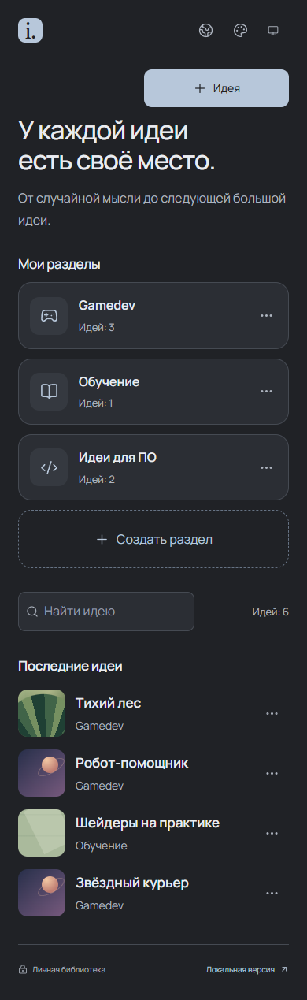

# Idea Bank

Idea Bank предназначен для хранения идей и связанных с ними материалов. Приложение поддерживает текстовые заметки, изображения, видео, аудио и интерактивные 3D-модели. Идеи объединяются в разделы, а содержимое каждой идеи размещается в отдельных блоках.

Доступны локальный запуск на компьютере и развёртывание личного сайта с синхронизацией между устройствами. Каждый экземпляр рассчитан на одного владельца и использует отдельное хранилище. Исходный код распространяется под лицензией MIT.

[Возможности](#возможности) · [Локальный запуск](#локальный-запуск) · [Облачное развёртывание](#облачное-развёртывание) · [Хранение данных](#хранение-данных) · [Резервные копии](#резервные-копии)


## Возможности

### Организация библиотеки

Каждая идея содержит название, описание, обложку и страницу с материалами. Разделы используются для группировки идей по направлениям, например разработке игр, обучению или программному обеспечению.

Поддерживаются:

- Создание, редактирование и удаление разделов и идей.
- Перенос идей между разделами.
- Поиск по названию и описанию.
- Готовые обложки с названием идеи и загрузка собственных изображений.
- Навигация по разделам и идеям в боковой панели.
- Просмотр четырёх последних идей на главном экране в мобильном интерфейсе.

### Содержимое идеи

Страница идеи состоит из блоков с текстом и вложениями. В одном блоке могут находиться несколько медиафайлов. Изображения открываются отдельно, видео и аудио воспроизводятся встроенными средствами браузера, 3D-модели доступны для вращения и масштабирования.


Для текста доступны жирное и курсивное начертание, подчёркивание, зачёркивание, цвет, размер шрифта, встроенный код и гиперссылки. Размер заголовка блока настраивается отдельно. Текст может располагаться над вложениями или под ними.

Поддерживаются модели GLB и glTF 2.0. При загрузке составной glTF-модели можно выбрать папку с ресурсами. Изображения, аудио, видео и модели можно скачать из приложения.

### Расположение блоков и медиа

Блок может занимать всю строку, половину или треть её ширины. Порядок меняется перетаскиванием за ручку или кнопками со стрелками. При перетаскивании соседние блоки плавно перемещаются на новое место.

Размер каждого окна медиа настраивается независимо. Высота ряда определяется самым высоким элементом. На узких экранах блоки отображаются в один столбец.


Для сохранения изменений используется кнопка с галочкой внизу справа. Рядом расположена кнопка отмены. При переходе с несохранённым черновиком приложение запрашивает подтверждение.

### Интерфейс

Доступны темы «Шалфей», «Нежно-голубая» и «Графит». Боковая панель сворачивается и поддерживает изменение ширины. Интерфейс адаптирован для компьютеров и телефонов.

Язык выбирается в меню с иконкой планеты: English или Русский. По умолчанию используется английский. Язык и тема сохраняются отдельно в каждом браузере; содержимое идей при переключении языка не меняется.



На скриншотах использованы демонстрационные данные. В исходной библиотеке присутствуют только раздел **Examples** и идея **Example** на английском языке. Пример содержит форматированный текст, изображение робота и его 3D-модель. Остальные идеи на скриншотах не входят в стартовую библиотеку.

## Варианты использования

| | Локальный запуск | Личный сайт |
| --- | --- | --- |
| Требования | Node.js и исходный код | Аккаунты GitHub, Vercel и Backblaze B2 |
| Авторизация | Не требуется | Через GitHub, только для владельца экземпляра |
| Доступ | В браузере на компьютере с запущенным приложением | С устройств, на которых доступен адрес сайта |
| Перенос данных | ZIP-копия | Ручная синхронизация с B2 или ZIP-копия |

Приложение не предусматривает регистрацию дополнительных пользователей и совместное редактирование. Для отдельной личной библиотеки необходимо развернуть собственный экземпляр.

## Локальный запуск

Установите [Node.js LTS](https://nodejs.org/en/download) и [Git](https://git-scm.com/downloads). Минимальная версия Node.js в `package.json` составляет 20.9.0. Файл `.nvmrc` указывает ветку 26 для менеджеров версий.

Откройте терминал и выполните:

```sh
git clone https://github.com/IdleSpace76/idea-bank.git
cd idea-bank
npm ci
npm run dev
```

Откройте **[http://127.0.0.1:3000](http://127.0.0.1:3000)**. Терминал должен оставаться открытым. Для остановки приложения нажмите Ctrl+C.

Для локального режима аккаунты, ключи и файл `.env.local` не требуются. Если облачная авторизация уже настроена, установите `IDEA_BANK_AUTH_MODE=local` в `.env.local` и перезапустите сервер для возврата к локальному режиму.

Вместо Git можно использовать **Code → Download ZIP** на GitHub. После распаковки выполняйте команды `npm ci` и `npm run dev` из папки с `package.json`. Ошибка `Missing script: dev` обычно означает, что терминал открыт в другой папке.

### Запуск в Windows

Запустите [runIdeaBank.cmd](runIdeaBank.cmd) двойным щелчком. Скрипт перейдёт в папку приложения, при необходимости установит зависимости и откроет браузер. Окно запуска должно оставаться открытым.

После обновления исходного кода повторно выполните `npm ci` для установки актуальных зависимостей.

### Запуск собранной версии

```sh
npm ci
npm run build
npm start
```

По умолчанию приложение доступно на `http://127.0.0.1:3000`. Этот адрес относится к устройству, на котором он открыт. Для доступа с телефона к той же библиотеке рекомендуется облачное развёртывание.

## Облачное развёртывание

Для личного сайта используется следующая конфигурация:

| Сервис | Назначение |
| --- | --- |
| GitHub | Хранение исходного кода и авторизация владельца |
| Vercel | Запуск приложения и серверных обработчиков |
| Backblaze B2 | Хранение текстов, обложек и медиа в одном закрытом bucket |

Открытый репозиторий содержит приложение и публичные примеры. Пользовательские идеи хранятся в B2. Отдельный закрытый GitHub-репозиторий для библиотеки не требуется.

Подробная последовательность настройки приведена в [руководстве по развёртыванию](docs/deployment.md). Оно включает регистрацию GitHub App, создание B2-хранилища, настройку переменных Vercel и проверку синхронизации.

Основные этапы:

1. Создайте Fork репозитория в своём GitHub-аккаунте и клонируйте его на компьютер.
2. Создайте закрытый bucket в B2 и отдельный ключ с доступом к нему.
3. Зарегистрируйте GitHub App для входа и определите числовой GitHub ID владельца.
4. Импортируйте форк в Vercel как Next.js-проект. Перед первым развёртыванием установите `IDEA_BANK_AUTH_MODE=github`, чтобы включить проверку владельца.
5. Добавьте постоянный адрес сайта в настройки callback GitHub App и заполните серверные переменные Vercel.
6. Разрешите адрес сайта в CORS своего B2 bucket и выполните Redeploy.
7. Войдите в приложение и проверьте передачу библиотеки между компьютером и телефоном.

Бесплатный [Vercel Hobby](https://vercel.com/docs/plans/hobby) предназначен для личного некоммерческого использования. У B2 предусмотрена бесплатная квота хранения; условия скачиваний и операций указаны на [странице тарифов](https://www.backblaze.com/cloud-storage/pricing). Руководство рассчитано на запуск без привязки карты и покупки домена. Бесплатные квоты ограничены, а предыдущие версии библиотеки и вложения учитываются в объёме хранения.

### Синхронизация устройств

Синхронизация запускается вручную через **Синхронизация → Синхронизировать**. На телефоне верхняя кнопка может отображаться только иконкой облака. В английском интерфейсе используются названия **Sync → Sync now**.

При первом подключении требуется выбрать направление переноса:

- На устройстве с нужной библиотекой выберите **Сохранить локальную в облаке**.
- На новом устройстве выберите **Загрузить облачную на устройство**.

При следующих запусках приложение сравнивает состояние устройства и облака с последней синхронизированной версией. Если изменения есть только с одной стороны, данные передаются в соответствующем направлении. Если изменились обе стороны, приложение предлагает выбрать библиотеку целиком. Автоматическое объединение отдельных абзацев не поддерживается. Предыдущие облачные версии сохраняются в истории.

Перед редактированием рекомендуется выполнить синхронизацию, а после сохранения правок повторить её. Это позволяет получить актуальную версию и передать новые изменения другим устройствам.

## Хранение данных

Для текстов и параметров блоков используется `localStorage`, для вложений используется IndexedDB. При настроенном облаке синхронизация передаёт тексты и файлы в закрытый B2 bucket. Медиа передаются напрямую между браузером и B2 по временным подписанным ссылкам.

Локальные данные привязаны к браузеру и адресу сайта. Для `localhost`, `127.0.0.1`, другого порта и опубликованного домена используются отдельные хранилища. Очистка данных сайта удаляет локальную библиотеку и вложения. Авторизация через GitHub защищает сайт и API, но не шифрует данные в профиле браузера.

В уже открытой вкладке доступна работа без сети. Для нового открытия или перезагрузки сайта требуется соединение: отдельный PWA-режим не реализован. Офлайн-изменения передаются после следующего ручного запуска синхронизации.

## Резервные копии

1. Сохраните или отмените текущий черновик.
2. Откройте **Локальная версия** или **Синхронизация и копии** внизу страницы.
3. Нажмите **Экспортировать ZIP** и сохраните архив.
4. Для переноса откройте приложение в другом браузере, выберите **Импортировать ZIP**, проверьте содержимое и нажмите **Заменить библиотеку**.

Архив содержит разделы, идеи, форматирование, расположение блоков, обложки и все вложения. Восстановление заменяет библиотеку целиком. Приложение проверяет контрольные суммы; при повреждении файла или ошибке записи прежняя библиотека сохраняется.

ZIP не зашифрован. Храните его отдельно от папки с публикуемыми исходниками. Резервная копия сохраняет состояние библиотеки на момент экспорта и используется независимо от облачной синхронизации.

## Ограничения текущей версии

- Один владелец на экземпляр приложения, синхронизация по кнопке.
- ZIP: до **512 МБ распакованных данных** и **9 997 вложений** на архив.
- Облако: до **1 ГиБ на медиафайл** и **3 МиБ на снимок текстов и метаданных**. Дополнительно учитываются память устройства и свободное место в браузерном хранилище.
- SVG не импортируется. Поддержка видео и аудио зависит от кодеков браузера.
- Для 3D требуется WebGL. Поддерживаются GLB/glTF 2.0; Draco/KTX2-сжатие не поддерживается.
- История ограничена 10 000 облачными снимками. Старые снимки и вложения не удаляются автоматически. Удаление родительских версий вручную может нарушить историю.

Технические сведения о хранении и разрешении конфликтов приведены в [docs/b2-storage.md](docs/b2-storage.md).

## Обновление и разработка

Перед обновлением сохраните правки и создайте ZIP-копию библиотеки. Если в рабочей папке нет собственных изменений, выполните:

```sh
git pull --ff-only
npm ci
npm run build
npm start
```

Для обновления форка доступна команда **Sync fork** на GitHub. При подключённой Git-интеграции Vercel создаёт новое развёртывание после обновления production-ветки. Статус отображается в разделе **Deployments**. Обновление исходного кода не сбрасывает данные браузера и B2.

Приложение использует Next.js App Router, React, TypeScript, Tiptap и Three.js. Авторизация реализована через Auth.js с проверкой ID владельца; доступ к облачному хранилищу осуществляется через S3-совместимый API B2.

Команды проверки:

```sh
npm run typecheck
npm run build
npm run test:e2e
npm run test:auth
npm run test:storage
npm run test:sync
npm run source:check
```

Браузерные тесты используют установленный Microsoft Edge и отдельные тестовые данные. Адрес по умолчанию использует порт 3000; другой адрес задаётся через `PLAYWRIGHT_BASE_URL`. Проверка `source:check` ищет известные признаки ключей и сохранённые JSON-библиотеки в публикуемых исходниках.

Порядок публикации кода описан в [docs/publishing.md](docs/publishing.md). Архив исходников, создаваемый командой `npm run source:zip`, не является резервной копией личной библиотеки.

## Лицензия

[MIT](LICENSE), Idea Bank contributors. Использование, изменение и распространение приложения допускаются при сохранении уведомления об авторских правах и лицензии.
